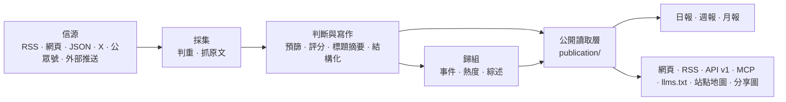

# 架構



## 三個程序

| 程序 | 位置 | 做什麼 |
|---|---|---|
| api | `apps/api/` | Fastify。網站自用介面（`/api/site/`）、公開 API（`/api/v1/`）、RSS、MCP、後臺介面、圖片代理、分享圖 |
| worker | `apps/worker/` | pg-boss 任務佇列和定時任務：抓信源、調模型、歸組、熱度、日報、告警、清理 |
| web | `apps/web/` | React Router 服務端渲染的網頁。只透過 HTTP 讀 api，不碰資料庫 |

業務程式碼都在 `packages/backend/`，前後端共用的型別和常量在 `packages/contracts/`。這個站自己的名字、文案、品牌和頁面在 `site/`，行業的分類、信源、提示詞和門檻在 `industry/`，只屬於這個站的功能在 `modules/`（見下文“模組”）。

## 幾條不變的規則

- **一個公開讀取層**：網頁、RSS、API、MCP、站點地圖、分享圖讀的都是 `packages/backend/src/publication/`。公開範圍、精選席位（機器出口每條新聞只出一條）與事實證據條件只在 `publication/scope.ts` 定義；新增出口也遵循當前的撤回和全文許可。已出刊報告保留當期寫作，但引用是否可公開、來源名和引用時間仍按當前資料判斷；撤回也要移除依賴該引用的導讀與封面。
- **快取不延長舊內容的壽命**：可變內容按響應的 `Cache-Control` 到期重新驗證，站點地圖的程序、磁碟與 HTTP 快取共用同一個截止時間，不能在傳送時重新計時；MCP 的 HTTP 響應使用 `no-store`。自建代理或 CDN 同樣要遵守，配置要求見 [部署](deploy.md#配域名和-https) 的“配域名和 HTTPS”。
- **頁面不調模型**：讀者開啟頁面只讀資料庫裡已經有的結果；模型只在 worker 的任務裡呼叫。
- **花錢的請求有回執**：每個付費請求（模型、X、公眾號、Jina）先記一張回執，拿到結果先存再用。程序重啟、任務重試時，複用已經付過錢的結果，不重複花錢（`providers/receipts.ts`）。結果不明的回執超過 30 分鐘後自動放行一次；因它停在失敗狀態的文章會重新入隊，繼續未完成的正文提取或分析。再次結果不明時，由管理員在“執行”頁核對後放行。
- **預算熔斷**：每個付費服務有每分鐘、每小時、每天的上限，超過就暫停（後臺“設定 → 付費請求上限”）。
- **安全閥**：`COLLECT_ENABLED`、`MODEL_CALLS_ENABLED`、`FEISHU_CONTENT_PUSH_ENABLED`、`FEISHU_INTERNAL_ENABLED`、`INDEXNOW_SUBMIT_ENABLED` 只決定“發不發出去”，不決定走哪套邏輯；只有設成 `true` 才開啟，沒寫就是關。`scripts/init-env.ts` 生成的 `.env` 會開啟採集和模型呼叫，只調介面時可以改成 `false`；測試裡推送一直關著，採集和模型呼叫只連本地假服務。
- **公開內容匿名**：管理員和訪客看到的一樣；讀者的收藏、已讀存在瀏覽器裡。後臺只允許管理員。
- **舊文不刷屏**：發現時已釋出超過 48 小時的資料、新信源第一次匯入的存量、回灌的推送，按原文時間歸檔，不進“今天”、不推送；第一次匯入之後不再收列表裡更早的存量。沒有可信釋出時間的資料先不公開，讀到日期後再判斷新舊。
- **來源可追溯**：每條精選都連結原文；站內是否顯示全文由信源的 `site_fulltext` 決定，預設只顯示摘要。
- **規則由所屬模組維護**：後臺呼叫內容、事件、通知與恢復模組，不直接改寫它們的狀態；業務模組不反過來依賴後臺。人工修改、公開結果與恢復所需記錄一起提交。
- **跨程序介面共享型別**：後臺介面以 `packages/contracts/src/admin.ts` 為準，任務載荷以 `jobs/queue.ts` 的 `JobData` 為準，傳送方和接收方一起檢查。前端仍只透過 HTTP 訪問後端。

這些模組邊界由 `tests/architecture.test.ts` 檢查；調整邊界時同時更新約定與檢查。站點身份和每一步的模型從 `site/` 讀，行業分類和提示詞從 `industry/` 讀，程式碼裡不寫死某個站的值。

## 目錄

| 位置 | 內容 |
|---|---|
| `site/` | 這個站自己的：站名文案、每一步的模型、品牌與 Logo、條款頁、網站根目錄的四個固定檔案（`public/`，替換佔位符後釋出）、更新日誌，以及啟用哪些模組（`site/modules/`） |
| `industry/` | 行業包：分類標籤、主題、示範信源、提示詞、門檻 |
| `modules/` | 只屬於這個站的功能，一個功能一個資料夾（見下文“模組”）；框架本身不帶模組 |
| `packages/backend/src/sources/` | 六種信源的讀取器，抓取排程（`collect.ts`） |
| `packages/backend/src/content/` | 資料入庫、判重、正文提取和清洗 |
| `packages/backend/src/editorial/` | 判斷與寫作：`analyze.ts`（流程）、`prompts.ts`（讀提示詞）、`models.ts`（每一步用哪個模型） |
| `packages/backend/src/events/` | 事件歸組、熱度、事件綜述 |
| `packages/backend/src/publication/` | 公開讀取層 |
| `packages/backend/src/reports/` | 日報、週報、月報 |
| `packages/backend/src/providers/` | 模型、向量、X、公眾號、Jina 的呼叫，回執與預算 |
| `packages/backend/src/notify/` | 飛書推送 |
| `packages/backend/src/operations/` | 告警、備份、清理、IndexNow |
| `packages/backend/src/admin/` | 後臺介面 |
| `apps/web/app/routes/` | 每個頁面一個檔案，路由表在 `apps/web/app/routes.ts` |
| `database/migrations/` | 資料庫遷移，按完整檔名排序執行和記賬 |
| `scripts/` | 初始化、遷移、種子資料、評測、檢查指令碼 |
| `tests/` | 後端測試（資料庫名必須以 `_test` 或 `_ci` 結尾，見下文） |

## 模組

框架裡沒有、只有你這個站要的功能（比如一個專門的榜單或監控頁），做成模組：一個功能一個資料夾 `modules/<名字>/`，是一個名為 `@aihot/<名字>` 的 npm 包，裝著它自己的後端、介面、頁面、樣式、資料庫遷移和測試。

| 檔案 | 內容 |
|---|---|
| `module.ts` | 它的地址：頁面、跳轉、交給 api 處理的路徑（型別見 `packages/contracts/src/modules.ts`） |
| `server.ts` | 它接進後端的插口：介面、定時任務、佇列、事件回撥、後臺頁面的資料等（`packages/backend/src/modules.ts`，每個插口註明讀它的檔案） |
| `web.tsx` | 它接進網頁的插口：頁面、導航項、主題頁與後臺的部件等（`apps/web/app/modules.ts`）；只在某一頁出現的部件給出載入函式，隨那一頁的程式碼載入 |
| `migrations/` | 它自己的表，和 `database/migrations/` 一起按檔名排序執行 |
| `tests/` | 它的測試，`npm test` 一起跑 |
| 其他檔案 | 它自己的圖片等靜態檔案也放在模組資料夾裡：在 `server.ts` 的 `http` 插口裡註冊路由，用 `apps/api/src/routes/static.ts` 的 `sendFile` 發出（型別、ETag、快取頭和 404 都由它處理，檔名自己校驗），地址寫進 `module.ts` 的 `apiPaths` |

寫好以後在 `site/modules/` 的三份清單裡列上它：`index.ts` 列地址，`server.ts` 列後端，`web.ts` 列網頁，沒有的那份不列；再在 `site/package.json` 的 `dependencies` 裡寫上它。用 Docker 部署的，在 `Dockerfile` 裡照著其他包加一行 `COPY modules/<名字>/package.json modules/<名字>/`。框架的程式碼不匯入任何模組，只讀這三份清單，所以合併本倉庫以後的更新時，不容易和你自己的功能衝突。插口不夠用時，在框架里加一個通用的插口，而不是把這個功能寫進框架。

模組透過 `agent.abilities` 提供 MCP 工具。`scripts/mcp-check.ts` 始終檢查完整工具集合；模組可在 `mcp.checkArgs` 中提供能在空資料庫上成功的檢查引數。未提供時，只有入參 schema 接受 `{}` 的工具會用 `{}` 實際呼叫；其餘工具只檢查發現，不猜引數。模組工具的業務行為由模組自己的測試驗證。

## 資料庫遷移

已經發布的遷移是部署歷史，不能改寫或刪除；修正放進新的檔案。引擎和模組的遷移遵循同一套約定：按完整檔名排序執行，並以完整檔名記錄是否已經執行；編號相同的不同檔案分別執行，同一完整檔名不能出現在兩個目錄中。從 `0055` 起，每個檔案只放一條允許線上執行的語句，PR 會拒絕不符合約定的新增遷移，也不允許用較小編號繞過檢查。這樣避免前一條語句鎖住表後，又在同一事務裡等待別的表或掃描大量資料。

新增列優先使用可空列或常量預設值；給已有表加 CHECK、外來鍵時先 `NOT VALID`，再用另一個遷移驗證。索引使用單獨的 `CREATE INDEX CONCURRENTLY IF NOT EXISTS`；不能在釋出遷移裡做大批 UPDATE、DELETE 或用 DO 隱藏它們。資料回填需另做分批、可觀測的操作，並先在備份副本上驗證。

多個篩選條件存在相關性、查詢計劃因此嚴重低估行數時，可以為這些列建立 MCV 聯合統計，再用單獨的遷移 `ANALYZE` 指定表的這些列。先用真實分佈驗證收益；不增加沒有依據的統計物件，也不在遷移裡做全庫分析或跳過被鎖住的表後假定成功。

改型別、刪列等破壞性變更需要單獨設計升級與回退步驟，在 [部署文件](deploy.md#更新) 說明對已有資料的影響；當前線上遷移檢查不會直接放行。程式碼已不再使用的表，確認可以刪掉它的資料後，單獨一個遷移檔案寫 `DROP TABLE IF EXISTS <表>`（不帶 CASCADE，仍有物件依賴它時遷移失敗），同樣在部署文件裡寫明。需要擴充套件允許的語句時，先證明它不會長期阻塞正在服務的請求，並補齊相應檢查，不能關閉檢查或修改舊賬本。

## 對外出口

事件的 `related` 關聯在建立時須有至少兩篇報道支撐。關聯歷史保留；橋接報道明確撤回、失去公開事實報道資格、改為綜合稿、移出原事實，或後續歸組判斷否定關係後，有效證據不足兩篇就不公開展示，恢復足夠證據後可重新展示。報道自然超出召回視窗、沿用歸屬的普通修訂不使關聯過期。沒有可核對橋接判斷的既有關聯，不從記錄缺失推斷撤回；事件本身不可公開閱讀時仍不推薦。`storyline` 的語義不隨這項規則改變，所有公開出口共用讀取規則。

| 地址 | 內容 |
|---|---|
| `/` `/all` `/hot` `/topics` `/daily` `/weekly` `/monthly` | 精選、全部動態、熱門事件、主題、日報週報月報 |
| `/feed.xml` `/feed/full.xml` `/feed/all.xml` `/feed/daily.xml` `/feed/weekly.xml` `/feed/monthly.xml` | RSS：精選、精選全文、全部、日報、週報、月報；另有按分類的 `/feed/category/<key>.xml` 和分類全文版 `/feed/full/category/<key>.xml` |
| `/api/v1/` | 公開 API，文件在 `/openapi-v1.json`；給 Agent 讀的 Markdown 從 `/api/v1/agent` 開始；說明頁在 `/agent` |
| `/api/mcp` | MCP 服務：最新、搜尋、熱點、事件、日報、週報、月報各一個工具，工具名字首是 `site/site.ts` 的 `mcpPrefix` |
| `/llms.txt` `/sitemap.xml` `/robots.txt` | 給大模型和搜尋引擎的說明（`robots.txt` 等根目錄檔案在 `site/public/`） |
| `/admin` | 後臺 |

## 測試

```bash
npm run typecheck
DATABASE_URL=postgres://127.0.0.1:5432/myhot_test npm test
npm run build -w @aihot/web && npm run test:web
```

`DATABASE_URL` 指向的庫名必須以 `_test` 或 `_ci` 結尾；沒有會自動建立並遷移。每個測試檔案在它的一份副本上並行執行，所以資料庫賬號要有建庫許可權（`CREATEDB`）。測試不訪問任何外部服務：模型和付費介面都由本地假服務回答。
